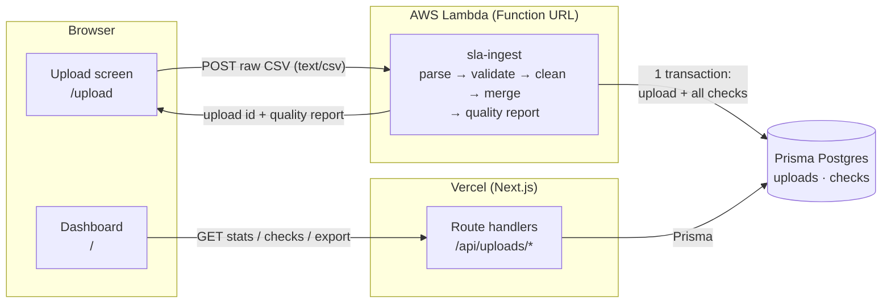

# SLA Monitoring Dashboard

Upload raw multi-agent health-check logs. A stateless AWS Lambda cleans them, Postgres stores them, and a
single-screen dashboard shows whether each service met its 99.9% SLA, what went wrong, and which credits are owed.
Every number traces back to the raw CSV rows it came from.

| | |
|---|---|
| **Live app** | `https://<your-app>.vercel.app` ← _fill in after deploy_ |
| **Ingest function** | https://jtjjiwvjnni4woauihtbov5l240bhpsu.lambda-url.ap-south-1.on.aws/ (AWS Lambda Function URL, `ap-south-1`; `GET` = health check) |
| **Last verified live** | _YYYY-MM-DD HH:MM IST_ |
| **Stack** | Next.js 16 (JavaScript) · antd 6 · Tailwind 4 · AWS Lambda (Node 22) · Prisma Postgres · Prisma 6 |

---

## Contents

1. [Architecture](#1-architecture)
2. [Data findings](#2-data-findings)
3. [Assumptions & decisions](#3-assumptions--decisions)
4. [Running, deploying, testing](#4-running-deploying-testing)
5. [What I'd do differently with more time](#5-what-id-do-differently-with-more-time)

---

## 1. Architecture



| Piece | Runs on | Why I chose it |
|---|---|---|
| **Upload UI + dashboard** | Next.js 16 on **Vercel** (Hobby, free) | One app for both screens. Route handlers sit next to the UI, so the read API needs no separate backend. Vercel deploys Next.js with zero config. |
| **Ingest function** | **AWS Lambda**, Node 22, exposed through a **Function URL** | Required by the brief. The free tier (1M requests and 400k GB-s per month) covers this many times over. A Function URL avoids API Gateway: one fewer service, and built-in CORS. The browser uploads **directly** to Lambda, so the processing step really is the cloud function and not a Next.js route posing as one. |
| **Database** | **Prisma Postgres** (free tier) | The data is relational and queried by time range, so Postgres with a `(upload_id, checked_at)` index is a natural fit. Prisma Postgres is managed Postgres from the same team as the ORM: one connection string, with pooling handled on its side, which matters when Lambda and Vercel functions each open connections. |
| **ORM** | **Prisma 6**, one schema in [`web/prisma/schema.prisma`](web/prisma/schema.prisma) | One source of truth used by both the writer (Lambda) and the reader (web). Migrations are versioned in git. The Lambda gets a synced, git-ignored copy before each `prisma generate` ([`sync-schema.mjs`](lambda/scripts/sync-schema.mjs)), because Prisma generates the client next to the schema's own package. |

### Request flow

1. **Upload**: [`UploadScreen`](web/src/components/upload/UploadScreen.js) sends the file as the raw request body (XHR, for progress events) to the Lambda Function URL.
2. **Process**: [`handler.js`](lambda/src/handler.js) validates the request (size ≤ 5 MB, not binary, not empty) and computes a **SHA-256 of the bytes**. If the same file was already processed, it returns that dataset (**idempotent re-upload**). Otherwise it runs the pure pipeline [`processCsv()`](lambda/src/pipeline/index.js).
3. **Persist**: [`persist.js`](lambda/src/persist.js) writes the `upload` row and all its `checks` in a **single transaction**, so the dashboard can never see a half-written dataset. Rejected files are stored as `FAILED` uploads with the reason, for auditability.
4. **Read**: the dashboard calls [`/api/uploads/:id/stats`](web/src/app/api/uploads/[id]/stats/route.js) (SLA analytics computed on read) and [`/api/uploads/:id/checks`](web/src/app/api/uploads/[id]/checks/route.js) (filtered, paginated logs).

### Design choices worth calling out

- **The pipeline is a pure function.** CSV text goes in; clean checks and a quality report come out, with no I/O. The handler is a thin adapter around it, which is why the cleaning rules are unit-tested and can be replayed against the answer key.
- **One row per (upload, service, 15-minute slot).** Enforced by a unique index, so a slot can never be double-counted.
- **Lineage is stored on every check.** `checks.sources` keeps the raw rows (line number, agent, original timestamp, status and latency) that were merged into the check, and `checks.flags` lists every fix applied. In the logs view, expanding a row shows why it was counted the way it was. That is the core of "the data decides the credit, so the pipeline must be trustworthy".
- **Stats are computed on read, not at ingest.** The SLA policy (target, credit tiers, incident rule) lives in [`config.js`](web/src/lib/sla/config.js). Changing it does not require reprocessing files, and at ~15k checks per dataset the computation takes milliseconds. Uploads are immutable, so these responses carry CDN cache headers.
- **Uploads are datasets.** Each upload is kept separately and chosen in the dataset picker. Two files covering the same days never merge silently.
- **Small Lambda bundle.** [`package.mjs`](lambda/scripts/package.mjs) ships only the Linux Prisma engine: an **8 MB zip** instead of ~115 MB, for faster cold starts. The function has no runtime dependencies besides Prisma; the CSV parser is ~60 lines and RFC 4180-compliant.

### Repository layout

```
lambda/            AWS Lambda ingest function
  src/pipeline/    csv.js · normalize.js · merge.js · issues.js · index.js (pure, tested)
  src/handler.js   Function URL handler · persist.js (Prisma transaction)
  scripts/         dev-server (local Function URL) · package (zip) · deploy (AWS SDK) · sync-schema
web/               Next.js app
  prisma/          schema.prisma + migrations (single source of truth)
  src/app/         / (dashboard) · /upload · /api/*
  src/lib/sla/     analytics.js + config.js (SLA, incidents, billing): pure, tested
  src/components/  dashboard/* · upload/*
data/              the provided CSVs + dataset_incident_log.json (answer key)
```

---

## 2. Data findings

I profiled all five files before writing the pipeline. Every issue below shows up in **every** file (the counts
differ), and every one has an issue code that is counted in the quality report, attached to the affected checks, and
shown in the dashboard's *Data quality* tab.

| # | Issue | Example from the data | How it's handled | Code |
|---|---|---|---|---|
| 1 | **Three timestamp formats** | `2025-05-08T16:15:00Z`, `1748729700` (Unix epoch), `2025-05-09T20:00:00+05:30` (IST) | All converted to UTC. I confirmed the +05:30 rows are correct local times, not mislabelled UTC: several are exact duplicates of a `Z` row once converted. | `TIMESTAMP_EPOCH`, `TIMESTAMP_TZ_OFFSET` |
| 2 | **Mixed latency units** | `svc-search` reports seconds (`0.486`, `s`); the other services report ms | Converted to ms, rounded to avoid float noise (`0.486 s` → `486 ms`, not `486.00000000000006`). | `LATENCY_UNIT_SECONDS` |
| 3 | **Two agents report the same slot** | ~7% of slots have rows from both `agent-1` and `agent-2`. `agent-1` alone already covers 100% of slots. | Merged into **one check per (service, slot)**. Counting rows instead of slots would inflate the denominator and distort availability. | `MULTI_AGENT` |
| 4 | **Exact duplicate rows** | Same agent and slot, sometimes in different timestamp formats (`1745064900` vs `2025-04-19T12:15:00Z`) | Detected *after* timestamps are normalised, then collapsed. | `DUPLICATE_ROW` |
| 5 | **Invalid status code** | `999` | Not a real HTTP status, so it becomes `UNKNOWN`, which is excluded from availability. It is never counted as a failure without evidence. | `STATUS_INVALID` |
| 6 | **Agents disagree** | Same slot: `agent-1` says `999`, `agent-2` says `200` | A valid status beats an invalid one, so the slot is UP. If two *valid* statuses disagree (UP vs DOWN), **DOWN wins**: a confirmed 5xx is evidence of an outage, and the SLA exists to protect the customer. | `AGENT_CONFLICT` |
| 7 | **Missing latency** | empty `latency`, mostly on 200s but also on some 502/503 rows | The check is kept for availability (the status is still valid) and excluded from latency percentiles. | `LATENCY_MISSING` |
| 8 | **Negative latency** | `-286 ms` | Physically impossible, so latency is set to null; the check is kept for availability. | `LATENCY_NEGATIVE` |
| 9 | **Rows not in time order** | ~50% of rows are earlier than the row before them | Order is never assumed: checks are keyed by (service, slot) and sorted. | `UNORDERED_ROWS` |
| 10 | **Unknown date range** | Not stated anywhere in the file | Inferred from the data as whole UTC days covering all checks. All five files match the answer key's `days`/`start`. | – |
| 11 | **Windows line endings** | CRLF | Parser handles CRLF/LF and a UTF-8 BOM. Sample files are committed byte-for-byte (`.gitattributes: *.csv -text`). | – |
| 12 | **Latency spikes** | 2–3 s on `reports-api` (p50 ≈ 650 ms) | **Kept.** They cluster around incidents, so they are real signal, not bad data. Visible as peak latency per incident and p99/max per service. | – |
| 13 | **Background error noise** | `reports-api` fails ~2.6% of checks at random, outside any outage | Counted as downtime (the customer saw a 5xx), but **not** paged as an incident. See §3. | – |

Per-file counts (rows → clean checks):

| File | Raw rows | Clean checks | Multi-agent slots | Duplicates | Epoch ts | +05:30 ts | Latency in s | Missing latency | Negative | `999` | Conflicts |
|---|---:|---:|---:|---:|---:|---:|---:|---:|---:|---:|---:|
| 9 d | 4,672 | 4,320 | 345 | 7 | 70 | 32 | 924 | 56 | 1 | 1 | 0 |
| 12 d | 6,230 | 5,760 | 460 | 10 | 93 | 43 | 1,229 | 74 | 1 | 1 | 0 |
| 14 d | 7,269 | 6,720 | 537 | 10 | 109 | 50 | 1,435 | 87 | 1 | 1 | 1 |
| 21 d | 10,904 | 10,080 | 806 | 18 | 163 | 76 | 2,151 | 130 | 1 | 1 | 0 |
| 30 d | 15,577 | 14,400 | 1,152 | 25 | 233 | 109 | 3,095 | 186 | 1 | 1 | 0 |

In every file, *clean checks = days × 96 × 5 services* exactly: no gaps once agents are merged, and no rows rejected.

**Problems the pipeline also handles, though they don't occur in these files** (because "break something
interesting" suggests other files will be tried): wrong or missing columns (rejected with the expected vs received
header), header-only or empty files, binary files, files over 5 MB, unparseable or calendar-invalid timestamps
(`2025-02-31`), timestamps before 2000 or in the future, timestamps off the 15-minute grid (snapped), timestamps
without a zone (assumed UTC, flagged), 4xx from the probe (`UNKNOWN`), unknown latency units, malformed rows,
inconsistent `service_name` for the same `service_id`, and **missing slots** (reported as coverage gaps per service).

### The finding that shaped the analytics: outages flap

The answer key says `svc-search` was down 12:00–16:45 on day 4 of the 12-day file. The data in that window looks like this
(`X` = 5xx, `.` = 200, one character per 15 minutes):

```
svc-search  day 4   ...........X.XXXXX.XXX.X.XXXXXX...........
svc-reports day 2   ...X.....................X..X.X...........   ← background noise, not an outage
```

Real incidents are **dense bursts with the odd successful check inside**. Counting only back-to-back failures would
split that outage into four incidents and report a 1h15m outage instead of 4h45m. Meanwhile some services throw
isolated 5xx all month. So the incident rule (§3) is "a cluster where failures are the majority", not "N in a row".

**Checked against the provided answer key**
([`answer-key.test.js`](web/src/lib/sla/answer-key.test.js) runs each CSV through the real Lambda pipeline and the
dashboard analytics): **all 8 documented incidents are detected, each matched exactly once, with start/end within
3 slots** of the documented check-points. There is one detection the key doesn't list: **`svc-search`, 16 May
10:15–11:00 (9-day file), three consecutive 5xx**. I report it on purpose: 45 minutes of hard failures is an outage
from the customer's point of view, whatever the generator intended. The test pins it as a known, accepted extra.

---

## 3. Assumptions & decisions

**SLA math**

- **Availability = UP ÷ (UP + DOWN)**, per service. `UNKNOWN` checks (invalid status, 4xx probe errors) and missing
  slots are excluded from both sides, because there is no evidence either way. Coverage is shown next to availability, so
  a service can't look healthy just by having no data.
- **2xx/3xx = UP, 5xx = DOWN, 4xx = UNKNOWN.** A health endpoint returning 404 means the probe is broken, not the service.
- **Each check stands for its whole 15-minute slot.** One failed check = 15 minutes of downtime. This is the only
  defensible reading at this sampling rate.
- **Isolated failures count toward the SLA.** The customer received a 5xx whether or not it was part of an
  "incident". Incidents are an operational lens (paging, MTTR); billing counts every failed check.
- **Billing period = calendar month in UTC**, evaluated per service. "Monthly availability" in the brief means credits
  are per month, so the 30-day file (6 Apr – 5 May) produces *two* billing periods. Partial months are flagged and their
  credits marked **provisional**, since the final number depends on days not in the file.
- **Credit tiers are an assumption.** The brief fixes only "< 99.9% → credit". I used the common cloud pattern:
  **< 99.9% → 10%, < 99.0% → 25%, < 95.0% → 100%**, with strict "below" (exactly 99.9% meets the SLA). This is one
  config object to change once the real contract is known.
- **Error budget** = 0.1% of observed check-minutes. With 15-minute checks, a 30-day month allows **43.2 minutes, which is
  fewer than 3 failed checks**. That is why every service in every file is in breach. The noise floor of `reports-api`
  alone (75 isolated failures in 30 days) is ~26× its budget. This is a real finding for the business, not a bug: 99.9% may be unrealistic for these
  services at this probe interval, or the probe is too strict.

**Incident rule** ([`config.js`](web/src/lib/sla/config.js)): a cluster of DOWN checks where (a) each failure is within
**2 healthy checks** of the previous one, (b) there are **≥ 3 failures**, and (c) failures are the **majority (> 50%)**
of checks in the cluster's span. Incident start = first failed slot; end = last failed slot + 15 min. I derived it
from how outages look in the data (above), and the answer key confirms it. It is not tuned to the key: the parameters are round
numbers that read naturally ("three strikes, mostly failing").

**Time zone**: everything is UTC: storage, display and date filters. The agents report UTC, the answer key is in UTC,
and a billing dashboard must not shift days depending on the viewer's laptop. The header shows a `UTC` tag.

**Why these stats?** I designed the stats section for its two readers:

| Reader | Question | What answers it |
|---|---|---|
| Billing | Did we breach, and what do we owe? | Fleet availability vs target · services in breach · **credits owed** (service-months) · *Billing periods* tab with per-month credit tier |
| On-call | What broke, when, and for how long? | Downtime · incidents + **MTTR** / longest · *Incidents* timeline · **daily heatmap** (when, not just how much) · last check state per service |
| Both | Are failures outages or chronic noise? | **Isolated-failure share**: 86% of failed checks in the 30-day file are *not* part of any incident. The SLA is being lost to a constant error rate, not to the outages that page people. Without it, someone would fix the incidents and still miss the SLA. |
| Engineering / audit | Can I trust these numbers? | **Clean source rows** + *Data quality* tab (every fix, with counts and line-numbered examples) + per-check lineage in the logs |

I left out a fleet-wide average p95 latency (it mixes very different services), uptime "nines" without the context
of the budget, and anything about regions: every row is `ap-south-1`, so a region breakdown would be decoration.

**Other decisions**

- **Logs filter**: a single UTC day *or* an inclusive date range (as the brief asks), plus service, outcome and
  data-quality flag. Filters live **in the URL**, so a view can be shared as a link ("auth-api on 22 Apr"). Clicking a
  heatmap cell, an incident or a service's *Failures* button jumps the logs to that slice; rows inside an incident are
  marked red. **Export CSV** returns exactly the filtered rows, for handing to support or billing.
- **Logs show cleaned checks, not raw rows.** The cleaned check is what the SLA is computed from, so it's what someone
  investigating a credit needs. The raw rows are one click away (expand a row).
- **Re-uploading the same file** returns the existing dataset (SHA-256 match) instead of duplicating it.
- **No auth, no multi-tenancy, no CI**, as the brief says. The Function URL is therefore public. It is limited by CORS to the
  dashboard origin, a 5 MB body cap and Lambda's free-tier concurrency. See §5.

---

## 4. Running, deploying, testing

### Prerequisites

Node 22+ and a Postgres database (local Postgres works for development; Prisma Postgres for production).

### Local development

```bash
cp .env.example .env                 # set DATABASE_URL (local Postgres is fine)
cp .env web/.env.local               # Next.js reads env from web/
(cd lambda && npm install)           # also syncs the schema and runs prisma generate
(cd web && npm install)
(cd web && npm run db:deploy)        # applies web/prisma/migrations
(cd lambda && npm run dev)           # local Function URL stand-in on :3001 (wraps the real handler)
(cd web && npm run dev)              # dashboard on :3000, in a second terminal
```

Open http://localhost:3000/upload and click one of the sample datasets.

### Tests

```bash
(cd lambda && npm test)   # 36 tests: CSV parsing, normalisation, merge rules, handler validation
(cd web && npm test)      # 22 tests: SLA analytics, query parsing, and the answer-key check
```

### Deploying (all free tier, ~15 minutes)

**1 · Database (Prisma Postgres)**: create a project at console.prisma.io, copy its direct connection string
(`postgres://…@db.prisma.io:5432/…`) into `.env` as `DATABASE_URL`, then run `(cd web && npm run db:deploy)`.

**2 · Ingest function (AWS Lambda)**: with AWS credentials in the environment (an IAM user allowed to manage Lambda
and create one IAM role):

```bash
cd lambda
INGEST_ALLOWED_ORIGINS="https://<your-app>.vercel.app" npm run deploy
```

[`deploy.mjs`](lambda/scripts/deploy.mjs) is idempotent. It packages the zip, creates or updates the IAM role (logs only),
the function (Node 22, 1 GB, 60 s) and a public Function URL with CORS restricted to the origin(s), then smoke-tests it
and prints the URL.

**3 · Web (Vercel)**: import the repo, set **Root Directory = `web`**, and add env vars `DATABASE_URL` and
`NEXT_PUBLIC_INGEST_URL` (the Function URL from step 2). Deploy. (`postinstall` runs `prisma generate`; `prebuild`
copies the sample CSVs from `data/`. [`vercel.json`](web/vercel.json) pins the functions to `sin1` (Singapore), next to the database: Vercel's default US region would add a round trip across the world to every query.)

**Redeploy on demand**: `(cd lambda && npm run deploy)` for the function; `git push` or "Redeploy" in Vercel for the web.

**Staying live**: AWS Lambda, Vercel Hobby and Prisma Postgres all have free tiers with no expiry. `GET /api/health` checks database connectivity.

---

## 5. What I'd do differently with more time

- **Direct-to-S3 uploads.** Function URLs cap payloads at 6 MB. For real log volumes: presigned S3 upload → S3 event →
  Lambda streaming the file (no size limit, retries for free), with the upload screen polling the status.
- **Protect the ingest endpoint.** Auth was out of scope, so the URL is public. Next steps: a signed upload token
  issued by the web app, reserved concurrency and AWS WAF rate limiting.
- **Bulk insert with `COPY`.** Prisma `createMany` is fine at 15k rows (~0.5 s); at millions of rows I'd stream into a
  staging table with `COPY` and merge in SQL.
- **Treat time as continuous, not per upload.** Today each upload is its own dataset. In production, overlapping uploads
  should merge into one timeline per service (the `(service, slot)` key already makes that safe), with the upload kept
  as provenance.
- **Agent health as a first-class signal.** When agents disagree, it could be the agent that is broken. With more
  agents I'd use majority voting and track per-agent disagreement rates.
- **Configurable SLA per service and contract**, stored in the database, with credits computed in currency.
- **Infrastructure as code** (SAM/Terraform) instead of an SDK script, and end-to-end tests (Playwright) for the
  upload → dashboard flow.
- **Precomputed rollups** (daily per-service aggregates) once datasets get large, rather than computing on read.
